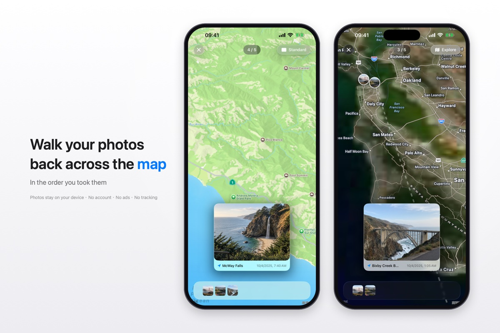
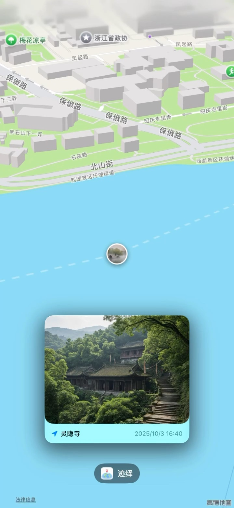
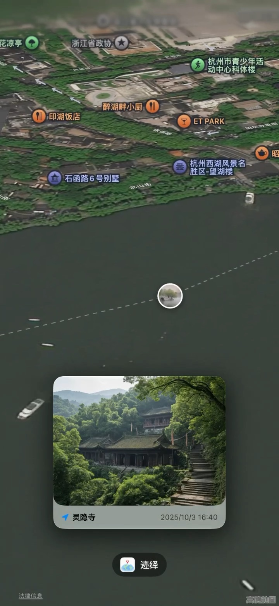
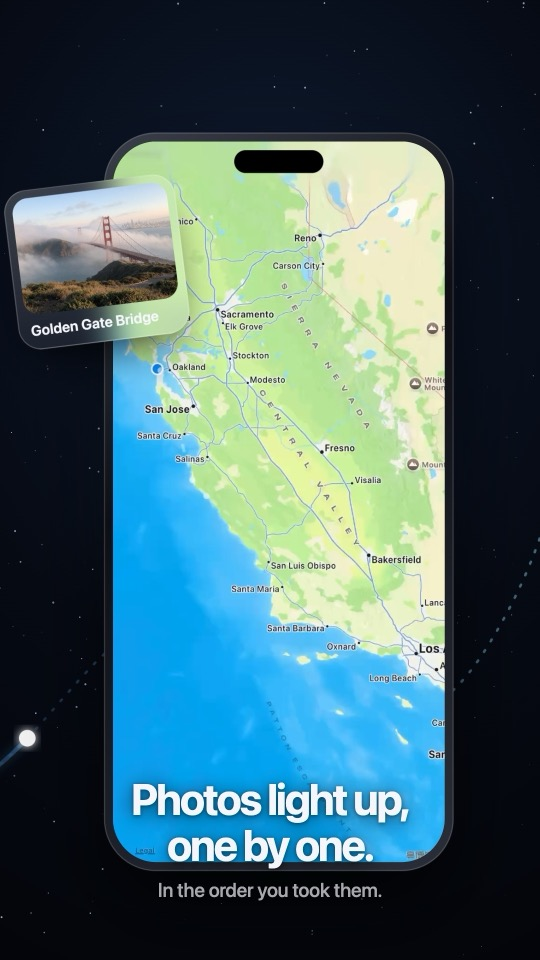

  

<h1 align="center">迹绎 Trace</h1>

  选几张带位置的照片，按拍摄顺序在地图上重走一趟旅程。

  <strong><a href="https://xfzz7.github.io/trace-site/">访问官网</a></strong>
  &nbsp;·&nbsp; <strong><a href="https://apps.apple.com/cn/app/%E8%BF%B9%E7%BB%8E-%E7%85%A7%E7%89%87%E8%BD%A8%E8%BF%B9%E5%9B%BE/id6769310458">在 App Store 获取</a></strong>
  &nbsp;·&nbsp; <a href="film/trace-replay-zh.mp4">观看江南旅程</a>
  &nbsp;·&nbsp; <a href="#trace-for-iphone-and-ipad">English</a>

适用于 iPhone 与 iPad · iOS 17 或 iPadOS 17 及以上

## 从相册到地图

打开迹绎，选一组旅途中的照片。迹绎会按拍摄时间排序，在地图上标出每一站。镜头从西湖一路移向灵隐，边走边亮起当时拍下的照片。

  
  &nbsp;
  

同一段江南回放。左为标准地图，右为 3D 卫星视角。

## 第一次怎么玩

1. **先看看示例。** 打开迹绎，在首页点「看看示例」。外滩、豫园、西湖、灵隐和拙政园会依次出现。这段示例无需访问相册。
2. **选一趟自己的旅行。** 点地图右上角的「＋」，选一组照片或视频。遇到没有位置信息的照片，可以搜索地名或在地图上补一个图钉。
3. **按自己的节奏重走。** 播放时可以暂停、左右滑动或拖动进度。切换地图样式时，仍可以沿着同一组照片回看旅程。

## 一趟旅程，可以留下什么

**旅程记录。** 播完后可以查看天数、里程和经过的地点。回到首页地图，点开记录就能再看一次。

**可分享的视频。** 播放前打开录制，回放中的实况照片和视频会一起录进短片。完成后可以保存到相册，或发给一起旅行的人。

## 两段示例旅程

一个从上海外滩出发，一个沿加州海岸南下。点击封面观看各 24 秒的真机演示短片。

  
  &nbsp;
  

  <a href="film/trace-replay-zh.mp4">江南旅程 · 中文</a>
  &nbsp;·&nbsp;
  <a href="film/trace-replay-en.mp4">California coast · English</a>

## 常见问题

**为什么有些照片没有落点？** 截图、从聊天软件保存的图片，以及拍摄时没有记录定位的照片，可能没有地理位置。可以只给这次回放补位置，也可以选择写回照片。

**地图上的线代表实际走过的每一段路吗？** 迹绎按拍摄时间连接照片的落点。两张照片之间的连线用来展示前后顺序，里程也依据这些落点计算。

**迹绎会上传照片或请求设备定位吗？** 照片和旅程记录在设备上处理。迹绎通过照片里的位置或手动标记来回放，无需调用设备定位。地图和地名来自 Apple 系统服务，需要联网。

## Trace for iPhone and iPad

Pick photos with location data and replay your trip on a map in the order you took them. Switch between standard and 3D satellite views, watch Live Photos and videos along the way, or export the replay as a video.

- **Start with the sample trip.** It runs without photo access.
- **Add a missing location.** Search for a place or drop a pin, then keep that edit for the replay or write it back to the photo.
- **Keep or share the trip.** Reopen it from your trip history, or record the replay and save it as a video. Photos and trip history are processed on your device.

**[Get Trace on the App Store](https://apps.apple.com/cn/app/%E8%BF%B9%E7%BB%8E-%E7%85%A7%E7%89%87%E8%BD%A8%E8%BF%B9%E5%9B%BE/id6769310458)** · [Official website](https://xfzz7.github.io/trace-site/?lang=en) · [Watch the California coast film](film/trace-replay-en.mp4)

---

这里是迹绎官网与宣传片的发布仓库。使用中遇到问题，可以联系[技术支持 / Support](mailto:whozz7@qq.com)。
